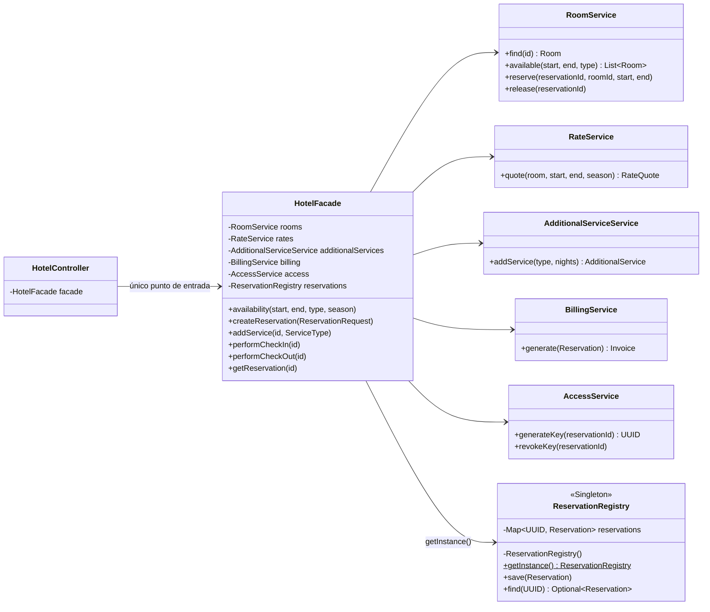
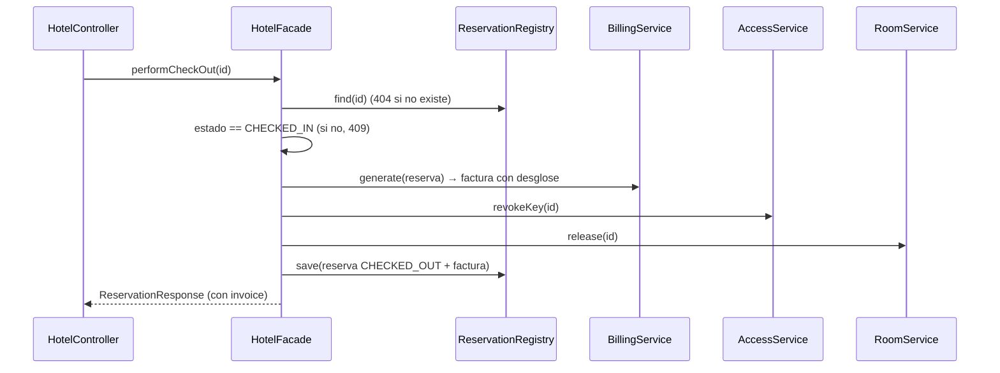

# Plan del Backend — Sistema de Reservas de Hotel (Facade + Singleton)

> Taller de Patrones de Software. Spring Boot 3.5, Java 17+, Maven. Despliegue en **Railway**.
> Estado en memoria con colecciones Java, sin base de datos.
> **El contrato vigente de la API es [`api-contract.md`](api-contract.md) / [`openapi.json`](openapi.json).** Este plan lo resume y no lo reemplaza.

---

## 1. Arquitectura de paquetes (implementada)

```
com.hotel
├── HotelApplication
├── controller/   HotelController            → cliente: SOLO usa HotelFacade
├── facade/       HotelFacade                → única puerta de entrada; orquesta todo
├── service/      RoomService, RateService, AdditionalServiceService,
│                 BillingService, AccessService (+ StayRules, validación de fechas)
├── repository/   ReservationRegistry        → Singleton con ConcurrentHashMap
├── factory/      RoomFactory, AdditionalServiceFactory
├── strategy/     PricingStrategy, High/LowSeasonPricingStrategy
├── model/        records inmutables + enums (Room, Reservation, Invoice.Builder…)
├── dto/          requests, HotelResponses, ApiResponse, ApiError
├── exception/    HotelException, GlobalExceptionHandler (@RestControllerAdvice)
└── config/       WebConfig (CORS)
```

| Taller | Clase en el código |
|---|---|
| HabitacionService | `RoomService` |
| TarifaService | `RateService` |
| ServicioAdicionalService | `AdditionalServiceService` |
| FacturacionService | `BillingService` |
| AccesoService | `AccessService` |
| crearReserva / agregarServicio / realizarCheckIn / realizarCheckOut | `createReservation` / `addService` / `performCheckIn` / `performCheckOut` |

El código está en inglés y los mensajes al usuario en español (decisión del equipo, ver `AGENTS.md`).

---

## 2. Patrones aplicados

| Patrón | Dónde | Por qué |
|---|---|---|
| **Facade** (obligatorio) | `HotelFacade` | El controller solo conoce la fachada. La fachada coordina los 5 subsistemas, que no se conocen entre sí |
| **Singleton** | `ReservationRegistry` | Debe existir **un único** registro de reservas en memoria para toda la app. Constructor privado + `getInstance()` (idiom *holder*: perezoso y thread-safe sin `synchronized`) |
| Strategy | `PricingStrategy` | Factor de temporada ALTA ×1.5 / BAJA ×1.0 |
| Factory | `RoomFactory`, `AdditionalServiceFactory` | Crean las 15 habitaciones y los extras con su precio |
| Builder | `Invoice.Builder` | Arma la factura línea por línea |

> **Nota sobre Singleton y Spring:** los beans de Spring ya son singleton por defecto (un objeto por contenedor). `ReservationRegistry` implementa el Singleton clásico del GoF (por clase/JVM) a propósito, para que el patrón sea visible en el código del taller.

---

## 3. Diagrama de clases



Los subsistemas no tienen flechas entre sí. `ArchitectureTest` (ArchUnit) lo verifica en cada build, junto con que solo la fachada use `ReservationRegistry`.

### Secuencia de `performCheckOut`



---

## 4. Contrato de la API (resumen)

Éxito: `{ "message": "...", "data": ... }` · Error: `{ timestamp, status, code, message, path, errors }`.

| Método | Ruta | Entrada | Respuesta |
|---|---|---|---|
| GET | `/api/hotel/disponibilidad` | query `checkInDate`, `checkOutDate`, `roomType?`, `season?` (LOW) | 200 `[{ room, rate }]`: incluye el preview de precio |
| POST | `/api/hotel/reservar` | `{ roomId, checkInDate, checkOutDate, season, guest{name, document, email, phone} }` | 201 reserva + `Location` |
| POST | `/api/hotel/servicios/{reservationId}` | `{ serviceType }` | 200 reserva |
| PUT | `/api/hotel/checkin/{reservationId}` | — | 200 reserva con `digitalKey` |
| PUT | `/api/hotel/checkout/{reservationId}` | — | 200 reserva con `invoice` |
| GET | `/api/hotel/reserva/{reservationId}` | — | 200 reserva |

Enums: `SINGLE/DOUBLE/SUITE`, `HIGH/LOW`, `SPA/BREAKFAST/TRANSFER`, `CONFIRMED/CHECKED_IN/CHECKED_OUT`.
Códigos: 400 validación/formato · 404 reserva o habitación inexistente · 409 ocupada, transición inválida o servicio duplicado.
Ejemplos completos en `docs/requests.http` y en el README.

---

## 5. Decisiones abiertas (las que tomó el equipo)

| Decisión | Valor |
|---|---|
| Precio base | SINGLE $100 · DOUBLE $150 · SUITE $250 |
| Temporada | **La elige el cliente** (`season`). No hay calendario de temporada alta (ver pendientes) |
| Habitaciones | 15: ids 1–6 SINGLE, 7–12 DOUBLE, 13–15 SUITE (números 101–115) |
| Llave digital | UUID en el check-in. Se revoca en el check-out |
| Servicios | Cada extra una sola vez por reserva (409 si se repite). Desayuno = $15 × noches |
| Ocupación | Rango semiabierto `[entrada, salida)`: se permiten estadías contiguas |
| Impuestos | No hay. `total = subtotal` |
| CORS | `CORS_ALLOWED_ORIGINS` acepta patrones. Por defecto `http://localhost:*`. Se rechaza `*` |

---

## 6. Revisión del commit `2cf80ce` (compañero)

| Punto | Estado | Comentario |
|---|---|---|
| 5 subsistemas | ✅ | Completos y con responsabilidad única |
| `HotelFacade` con los 4 métodos | ✅ | Más `availability` y `getReservation` para el controller |
| Controller solo usa la fachada | ✅ | Verificado con ArchUnit |
| Services no se importan entre sí | ✅ | Verificado con ArchUnit |
| 15 habitaciones de 3 tipos | ✅ | `RoomService` + `RoomFactory` |
| Endpoints exactos | ✅ | Las 6 rutas del taller |
| Errores 400/404/409 | ✅ | `@RestControllerAdvice` con JSON uniforme |
| `server.port=${PORT:8080}` | ✅ | |
| Preview de precio | ✅ | `rate` en disponibilidad |
| Reservas en `ConcurrentHashMap` | ⚠️ → ✅ | Era `HashMap` dentro de la fachada. Se movió a `ReservationRegistry` (Singleton) |
| CORS `http://localhost:*` | ❌ → ✅ | Solo aceptaba orígenes exactos. Se cambió a `allowedOriginPatterns` |
| Test unitario de la fachada | ⚠️ → ✅ | Solo había tests HTTP. Se agregó `HotelFacadeTest` |
| Temporada elegida por el cliente | ⚠️ pendiente | El taller dice "según temporada". Hoy el front puede mandar LOW en fechas de alta. Cambiarlo afecta el contrato del front: **decidir en equipo** |
| `StayRules` y `HotelException` en services | ⚠️ menor | Los subsistemas conocen `HttpStatus`. Aceptable para el taller |

---

## 7. Checklist del taller

- [x] HabitacionService: disponibilidad por fechas y tipo, reservar, liberar
- [x] TarifaService: base × noches × factor (ALTA 1.5 / BAJA 1.0)
- [x] ServicioAdicionalService: SPA 50, DESAYUNO 15/día, TRASLADO 30
- [x] FacturacionService: factura con desglose
- [x] AccesoService: llave UUID
- [x] HotelFacade obligatorio con crearReserva, agregarServicio, checkIn, checkOut (cobros, factura, liberar)
- [x] ≥ 15 habitaciones predefinidas
- [x] Estado en memoria con colecciones Java (`ConcurrentHashMap` en el Singleton)
- [x] 6 endpoints REST exactos
- [x] Errores JSON 400/404/409
- [x] CORS localhost:* + Vercel por variable de entorno
- [x] `server.port=${PORT:8080}`
- [x] Patrón Singleton (`ReservationRegistry`)
- [x] Tests: `RateServiceTest`, `HotelFacadeTest`, `HotelApiTest`, `ConcurrencyTest`, `ArchitectureTest` (19 tests)
- [x] Colección `.http` (`docs/requests.http`)
- [ ] Decidir temporada por calendario vs. elegida por el cliente
- [ ] Desplegar en Railway y configurar `CORS_ALLOWED_ORIGINS` con el dominio de Vercel
- [ ] Frontend en Vercel consumiendo la URL de Railway
